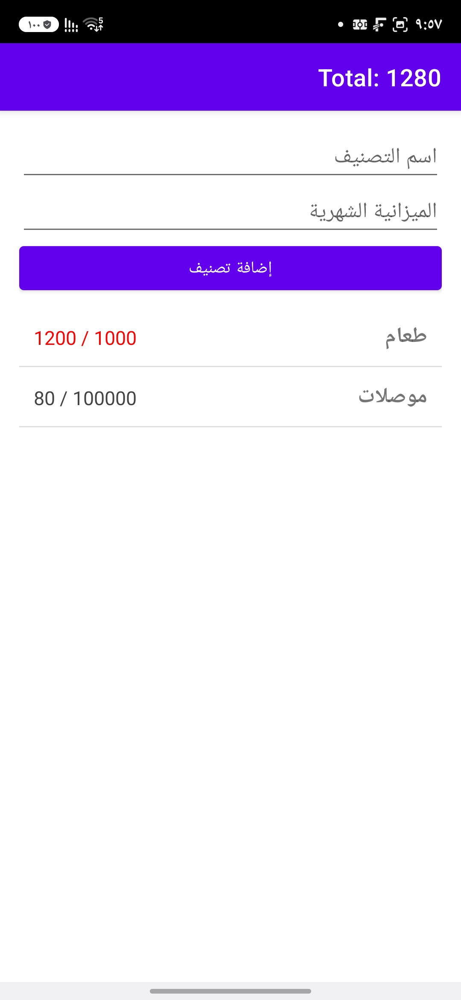
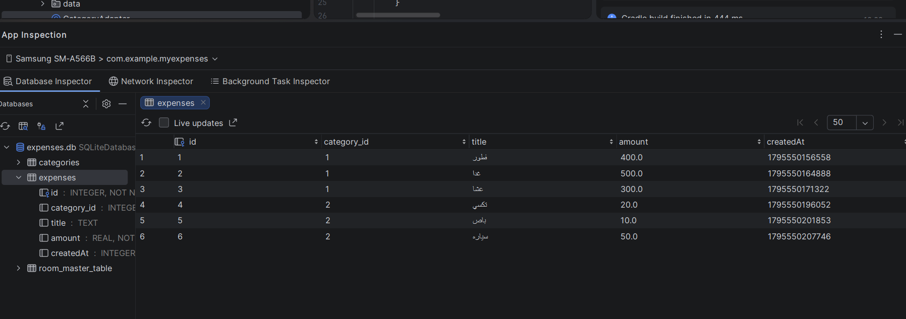

# MyExpenses - W2 Room Assignment 1

**الاسم:** بهاء ____________  
**الرقم الجامعي:** 120250176  
**المساق:** DCSC 2305

تطبيق لتسجيل المصاريف الشخصية موزعة على تصنيفات (مواصلات، طعام، كتب...) باستخدام قاعدة بيانات Room بجدولين بينهم علاقة واحد إلى متعدد.

## الجداول
- `categories` (Category): id, name, budget
- `expenses` (Expense): id, category_id (مفتاح أجنبي مع CASCADE), title, amount, createdAt

## الشاشات
- **MainActivity:** إضافة تصنيف، عرض التصنيفات بشكل `المجموع / الميزانية`، الرقم أحمر إذا تجاوز الميزانية، ومجموع كل المصاريف في العنوان (Total).
- **ExpensesActivity:** إضافة وعرض مصاريف التصنيف المختار (من الأحدث للأقدم).
- الضغط المطول على تصنيف أو مصروف يحذفه بعد التأكيد.

## صور
### شاشة التصنيفات (فيها تصنيف متجاوز)

### جدول expenses من Database Inspector

